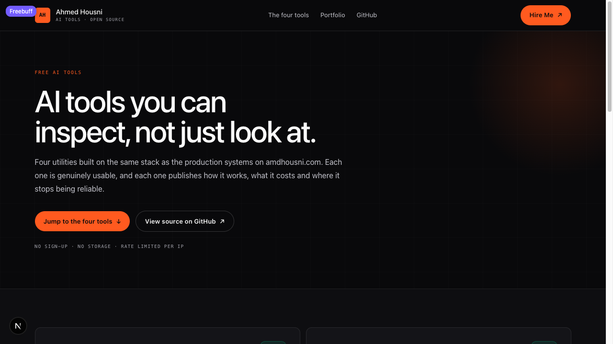
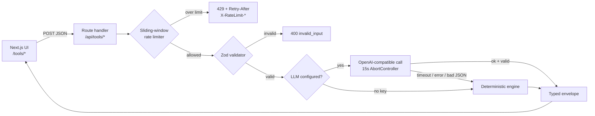

# amdhousni-ai-tools

[](https://github.com/amdhousni/amdhousni-ai-tools/actions/workflows/ci.yml)
[](./packages/core/tests)
[](./packages/core/tests)
[](./package.json)
[](https://www.typescriptlang.org/)
[](./LICENSE)

**Four production-grade AI engineering tools — built like product, not like a demo.**

Live: **[amdhousni.com/tools](https://amdhousni.com/tools)** · Token estimator → [live](https://amdhousni.com/tools/token-estimator) · Extractor → [live](https://amdhousni.com/tools/schema-extractor) · Fit analyzer → [live](https://amdhousni.com/tools/fit-analyzer) · RAG inspector → [live](https://amdhousni.com/tools/rag-inspector)

Every endpoint validates its input, rate-limits per IP, calls a model with a hard timeout, falls back to a real deterministic implementation when it cannot, and returns the same typed envelope either way. **The suite and the build pass with zero API keys.**



---

## What's in here

```
packages/core/          Pure TypeScript. No React, no Next.js, no DOM.
  contracts/            Zod request schemas + the shared response envelope
  llm/                  OpenAI-compatible adapter: timeout, JSON mode, typed failures
  rate-limit/           Sliding window: Redis/Valkey when available, memory otherwise
  profile/              Ahmed Housni's structured profile — evidenced skills only
  tools/                token-estimator · json-extractor · jd-fit-analyzer · rag-inspector
  tests/                60 Vitest unit & contract tests, 0 external calls

apps/web/               Next.js 15 App Router + Tailwind v4
  app/tools/            Hub + four interactive tool pages
  app/api/tools/        Four validated POST endpoints
  components/           Dark obsidian + orange UI, shared telemetry & "Under the hood"
```

The split is the point: the engines are testable in milliseconds without a browser, a provider or a database, and the UI is a thin, honest client of one contract.

---

## Architecture



The envelope is identical in every branch, so the interface can always tell the visitor which engine answered:

```jsonc
{
  "ok": true,
  "mode": "live" | "deterministic-fallback",
  "meta": {
    "latencyMs": 412,
    "model": "gpt-4o-mini",          // or "deterministic"
    "estimatedTokens": { "input": 640, "output": 180 },
    "estimatedCostUsd": 0.000204,
    "rateLimitRemaining": 18
  },
  "data": { }
}
```

---

## The four tools

| # | Tool | Endpoint | What it does | Fallback strategy | Key trade-off |
|---|------|----------|--------------|-------------------|---------------|
| 01 | **LLM Token & Cost Estimator** | `POST /api/tools/token-estimator` | Token counts, context-window usage, per-1k and monthly cost across 11 model tiers | None needed — deterministic by design (no model call, $0) | ~10–15% error on prose; list prices, not a quote |
| 02 | **Structured JSON & Schema Extractor** | `POST /api/tools/json-extractor` | Strict JSON + JSON Schema (Draft 2020-12) + Ajv validation + confidence notes | Regex + `key: value` entity extractor with the same schema derivation | Field selection is inferred; rules find entities, not semantics |
| 03 | **Role / JD Fit & Gap Analyzer** | `POST /api/tools/jd-fit-analyzer` | Weighted coverage, matched skills with evidence, genuine gaps, interview angles | Weighted keyword taxonomy over the published profile — the score is always computed, never generated | Keyword coverage under-weights transferable experience |
| 04 | **RAG & Context Q&A Inspector** | `POST /api/tools/rag-inspector` | Chunking with measured overlap, per-chunk scores, cited answer, refusal threshold | BM25 + extractive answer with the same citations and refusal rule | BM25 is lexical; chunker splits on sentences, not document structure |

---

## Requirements

- **Node.js ≥ 20.9** (declared in `engines`), npm 10 or newer
- No database, no Redis, no API key and no Docker needed for typecheck, tests or the production build
- Redis and a model key are optional runtime upgrades, never build prerequisites

## Quickstart

```bash
git clone https://github.com/amdhousni/amdhousni-ai-tools.git && cd amdhousni-ai-tools
npm install
npm run dev            # http://localhost:3000/tools
```

No key required: every tool works immediately in deterministic mode, and the UI labels it.

Useful scripts (all run from the repo root):

| Command | What it does |
|---|---|
| `npm run typecheck` | `tsc --noEmit` in both workspaces |
| `npm run lint` | ESLint (core + Next.js) |
| `npm test` | Vitest, 60 tests, no network |
| `npm test -- --coverage` | Same suite with a V8 coverage report (79% lines, 80% branches) |
| `npm run build` | Production Next.js build |
| `npm run verify` | typecheck → lint → test → build, in that order |

---

## Environment variables

| Variable | Required | Default | Notes |
|---|---|---|---|
| `LLM_API_KEY` | no | — | Any OpenAI-compatible provider key. Absent → deterministic mode everywhere. |
| `LLM_BASE_URL` | no | `https://api.openai.com/v1` | OpenAI, OpenRouter, Groq, DeepSeek, Qwen, Gemini compatibility endpoint. |
| `LLM_MODEL` | no | `gpt-4o-mini` | Model id passed to the provider. |
| `LLM_TIMEOUT_MS` | no | `15000` | Hard abort for a provider call (AbortController). |
| `LLM_EMBEDDINGS_MODEL` | no | — | Enables cosine retrieval in the RAG inspector. Unset → BM25. |
| `REDIS_URL` | no | — | Shared sliding window. Unreachable → memory fallback, never a 500. |
| `RATE_LIMIT_MAX` | no | `20` | Requests per IP per window. |
| `RATE_LIMIT_WINDOW_SECONDS` | no | `300` | Window length. |
| `NEXT_PUBLIC_SITE_URL` | no | `https://amdhousni.com` | Canonical origin and Hire Me target. |
| `NEXT_PUBLIC_REPO_URL` | no | this repo | Used by every "View source on GitHub" link. |

---

## Tests & CI

`packages/core/tests` — 60 tests, no provider key, no network. Current coverage on `packages/core/src`: **79.06% statements/lines, 80.21% branches, 75.47% functions** (`npm test -w @amdhousni/core -- --coverage`). The untested remainder is the provider adapter, which needs a live key by definition.

- **chunking** — token budget, measured overlap, hard-splitting an oversized sentence, overlap clamped to half the chunk size
- **retrieval** — BM25 ranking and normalisation, cosine similarity, citation selection, refusal below the threshold
- **token & cost** — token heuristic (including non-ASCII), per-million pricing, per-1k and monthly projections, unknown-model handling
- **extraction** — entity rules, `key: value` fields, schema derivation, Ajv validation, "no invented values" invariant
- **fit** — weighted scoring bounds, matched evidence, honest gaps, profile integrity (six certificates, no credential URLs or IDs)
- **rate limit** — sliding-window allow/block, per-key isolation, window expiry, malformed `REDIS_URL` degradation
- **contracts** — envelope shape, unknown modes, negative counters, missing payload fields

`.github/workflows/ci.yml` runs `install → typecheck → lint → test → build` on every push and pull request to `main`, with no secrets configured.

---

## Design decisions worth defending

1. **One envelope, validated by Zod.** A tool that returns a different shape on failure pushes the bug into the UI. `mode` is part of the contract so "the model answered" and "the fallback answered" can never be confused.
2. **The model never sets the score.** In the fit analyzer the coverage number is arithmetic over a published profile; the model may rewrite evidence and angles, and any skill it mentions outside the computed sets is dropped.
3. **Citations are a whitelist, not a suggestion.** The RAG inspector checks every cited chunk id against the chunks it sent and silently drops the rest — an answer cannot cite a document that was never retrieved.
4. **Fallbacks are real implementations.** The deterministic paths are not stubs returning "demo": the chunker chunks, BM25 ranks, the extractor validates against a generated schema. They are narrower, not fake.
5. **A limiter that degrades.** Redis is a shared counter, not a dependency: an outage downgrades to in-memory rather than taking the endpoint down, and the response still carries `X-RateLimit-*`.
6. **Cost is on the wire.** `estimatedTokens` and `estimatedCostUsd` ship in every response, because an AI tool without a cost signal is a demo.

Known trade-offs are listed per tool on each page, and in `packages/core/src/tools/*` next to the implementation.

---

## Certificates

The profile names six certificates — IBM RAG and Agentic AI, IBM Generative AI Engineering, IBM AI Engineering, IBM Full Stack Software, IBM DevOps and Software Engineering, and Wild Code School — Data Analytics.

**No credential URLs, verification links, badge embeds or credential IDs are present in this repository**, by design. A test enforces that.

---

## License

MIT © Ahmed Housni — see [LICENSE](./LICENSE).
